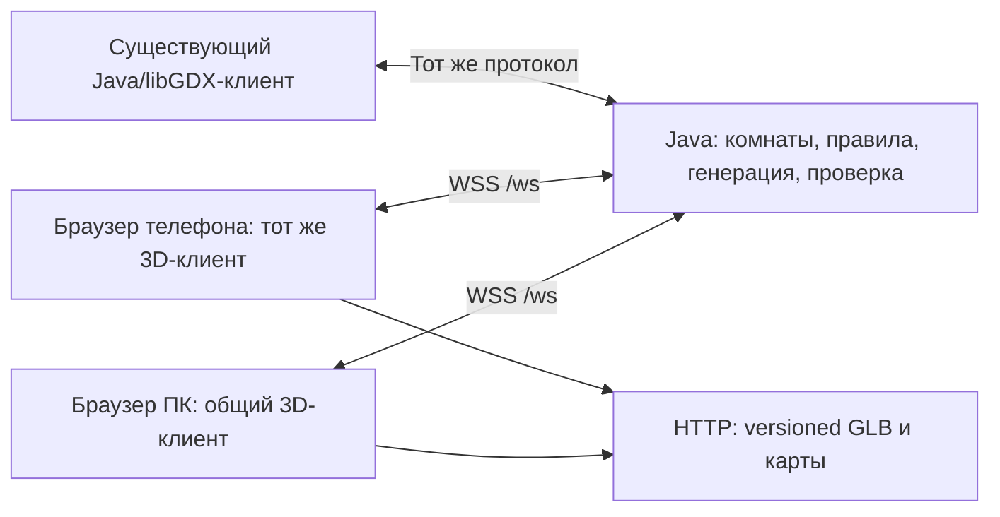

# Final Answer: план браузерной 3D-архитектуры

Статус: анализ и предложение, этапы 1–2. Браузерная реализация не начата, новые зависимости не установлены. По отдельному подтверждению пользователя улучшена существующая Java/libGDX-визуализация; GLB сохранены без изменений. Результаты — в `docs/THE_LAST_COMMAND_VISUAL_UPDATE.md`.

## 1. Что найдено в проекте

| Часть | Фактическая реализация |
|---|---|
| Сборка | Java 21, Gradle; core, lwjgl3, server, shared, inspector. HTML/GWT/TeaVM target не подключён |
| Desktop | libGDX 1.14.2, LWJGL3, Screen/Scene2D, FreeType, собственные контроллеры камер и анимаций |
| 3D | gdx-gltf 2.3.0, GLBLoader, SceneManager/PBR, пользовательские GLSL-слои материалов |
| Сервер | Javalin 7.2.3; HTTP комнат и JSON WebSocket /ws; самостоятельный Gradle-модуль |
| Общие данные | shared: Protocol, контент вопросов, настройки и фазы игр, общие cinematic timelines; без libGDX dependency |
| Браузер | web/: HTML/CSS/обычный JavaScript, DOM и Canvas2D; join/reconnect, ответы, голоса и контроллеры. Three.js/Babylon/WebGL-сцены не обнаружены |
| Игры | PlayScreen/round-представление; ImpostorScreen + ImpostorSession; CursedBoxesScreen + CursedBoxesSession; lastcommand + LastCommandSession |
| Доставка | server копирует web и ограниченный набор 2D/audio-ресурсов. Публикация всех GLB на телефоны сейчас намеренно отсутствует |

Ключевые источники: `settings.gradle`, `core/build.gradle`, `server/build.gradle`, `FinalAnswerGame.java`, `server/.../RoomServer.java`, `RoomService.java`, `LastCommandSession.java`, `web/app.js`, `docs/architecture/multiplayer-protocol.md`. При расхождениях старого описания и кода приоритет у кода и тестов.

Сервер уже валидирует роли, phase/session, requestId и изменения состояния. Используются персональные snapshots, revision/serverTime, reconnect, ограничения размера и частоты сообщений. Транспортная оболочка имеет protocolVersion=1. Но оркестрация ряда игр ещё зависит от ведущего: PRESENTATION_READY/REVEAL_READY/NEXT_READY, CURSED ready и started/impact/complete. В CursedBoxesSession тайм-аут ожидания сцены приводит к HOST_SCENE_PAUSED. Поэтому переход нельзя свести к замене отрисовки на телефоне.

В текущей модели host выделен отдельно от списка игроков; вместимость комнаты относится к гостям. Браузерный host должен получить административный интерфейс. Если ведущий тоже должен входить в число 2–8 игроков, это отдельное согласованное изменение roster/ролей, а не эффект выбора браузера. Гостевой игрок на ПК и гостевой игрок на телефоне должны иметь одинаковые игровые права.

### THE LAST COMMAND

Готовы: корпус, большая кнопка, четыре цветные кнопки, регулятор, лампа с fade/blink, трёхпозиционный рычаг, люк с подсказкой и двумя допустимыми seed-точками, кодовая панель с восемью областями выбора. Реализованы pivot-анимации, nearest-surface ray picking, блокировки, история, reset/dispose, камера и сохранение состояния при смене качества.

Кодовая панель закреплена над экраном. Область экрана зарезервирована для вопросов и защищена проверкой пересечения.

Полного набора из двадцати заданий нет. LastCommandSession хранит общую панель и принимает действия; правила новых головоломок и проверка их решений ещё требуют разработки на сервере. Существующий локальный CodePanel.matches — помощник, а не основание доверять клиентской проверке ответа.

Ресурсы:

- `assets/models/last_command/`: box_final, hole_final, button, adjuster, light; assembly.json, panel.json, mechanisms.json, surface.json.
- Исходники новых механизмов в корне: level_handler, lever, secret_hole, door, code_display. В level_handler фактически основание, в lever — рукоятка.
- Runtime-варианты всех десяти моделей: `assets/models/last_command/{low,medium,high}/`.
- Манифест подготовки: optimization.json; прежние измерения: `generated/last-command-performance/`.

Сохранены shared geometry/textures кнопок, mipmaps, подготовленные карты и геометрия, frustum/частично обратное отсечение, кэш теней, idle rendering по запросу, лимиты 30/60, диагностика. Эти принципы переносим, Java-вызовы GLProfiler/SceneManager — нет.

## 2. Решение по технологии

Рекомендация: **Java остаётся единственным владельцем правил; TypeScript + Three.js/WebGL2 становятся общим браузерным представлением ПК и телефона; используется существующий WebSocket**. Это поэтапное добавление клиента к работающему серверу, с сохранением Java/libGDX-приложения.

Причины: серверная логика уже отделена; существующий web уже работает с JSON и комнатами; исходные GLB подходят для стандартного glTF-пути; можно самостоятельно контролировать asset lifetime, render passes и модульную загрузку. TypeScript нужен для контрактов и расширения до двадцати модулей. Vite предлагается как инструмент разработки/сборки после утверждения; React/R3F и новый backend для этого не обязательны.

| Вариант | Повторное использование | Риски и решение |
|---|---|---|
| Three.js + TypeScript | Java-сервер, контракты, GLB, калибровки, контент; презентацию адаптировать | Рекомендуемый путь при минимальном требовании WebGL2; производительность предстоит измерить |
| libGDX + GWT | Потенциально больше Java-презентации | HTML-target сейчас отсутствует; JVM API, FreeType и reflection требуют адаптеров. gdx-gltf документирует ограничение embedded/binary GLB для GWT. Не является простым экспортом текущего приложения |
| libGDX + gdx-teavm | Перспективен для повторного использования core/анимаций | Текущий проект backend поддерживает libGDX 1.14.2, JS/Wasm и web FreeType. Совместимость именно наших GLB, custom shaders, Java API и Safari пока не проверена. Возможен ограниченный сравнительный spike после согласования |
| Babylon.js | Те же Java-правила и GLB; новые browser views | Полноценная альтернатива, особенно если обязателен WebGL1. Более широкий набор игровых подсистем не отменяет проверки конкретных устройств |
| WebGPU как единственный backend | Сервер/ресурсы | Не выбирать обязательным для первого этапа совместимости. Позднее можно оценить как дополнительный путь, без второго набора правил |

Three.js WebGLRenderer требует WebGL2. Нельзя обещать поддержку любого Android по названию браузера: проверять реальное создание контекста, доступные форматы и лимиты. При обязательной поддержке WebGL1 нужно пересмотреть выбор в пользу Babylon.js до реализации. Неподдерживаемое устройство нельзя молча переводить в режим «только контроллер» и считать требование полноценной 3D выполненным.

Источники: [Three WebGLRenderer](https://threejs.org/docs/pages/WebGLRenderer.html), [GLTFLoader](https://threejs.org/docs/pages/GLTFLoader.html), [GWT specifics](https://libgdx.com/wiki/html5-backend-and-gwt-specifics), [gdx-gltf limitations](https://github.com/mgsx-dev/gdx-gltf#webgl-limitations), [gdx-teavm](https://github.com/xpenatan/gdx-teavm), [Babylon specifications](https://www.babylonjs.com/specifications/). Выбор основан на архитектуре и документации, а не на ещё не проведённом браузерном benchmark.

## 3. Что сохраняем и что адаптируем

Сохраняем Java/libGDX-версию и исходные GLB; правила и контент Java, действующие HTTP /rooms и /ws, аутентификацию, идентификаторы, персональные состояния, дедупликацию и основную структуру комнат. Старые клиенты продолжают работать во время пилота. Извлечение общих интерфейсов выполняется через адаптеры, без переписывания сразу всех игр.

Адаптация обязательна для:

1. Scene2D/Screen, renderer/material hooks, input/camera, dynamic textures, audio и lifecycle браузерного клиента. Java-классы GLBLoader/SceneManager/GLProfiler не выполняются в TypeScript.
2. java.net.http, executor/thread callbacks, native file/window/audio APIs. В браузерном клиенте их заменяют browser APIs; сервер остаётся JVM-приложением.
3. Авторских координат: GLB node transforms, единиц, осей и pivot. Java setEulerAngles и стандартный порядок Euler в Three.js нельзя механически отождествлять. Экспортировать общую калибровку с quaternion/matrix и regression fixtures; не центрировать каждую модель/LOD заново.
4. Host-dependent animation ACK и readiness: правила времени должны принадлежать серверу, а представление восстанавливаться по phaseStartedAt/deadline. Декодирование сцены одним клиентом не должно бесконечно блокировать всех; нужен ограниченный по времени readiness/reconnect policy. Роль ведущего для start/settings сохраняется.
5. Выдачи seed/раскладки. Сейчас размещение люка выбирает Java-клиент. В целевой системе сервер выдаёт canonical placementId и version конфигурации из заранее проверенного набора. Private puzzle seed/ответ не отправляются клиенту; исходный PRNG не дублируется в JavaScript.
6. Доставки 3D: публиковать только производные web bundles по allowlist. Нужны hash/version URLs, MIME, кэш, HTTP compression для применимых файлов, проверка CSP для loader/worker/Wasm/blob. Не открывать весь каталог assets или исходники сервера.
7. Браузерного ведущего и хостинга. Java backend развёртывается как HTTPS/WSS-сервис. Desktop LocalServerManager/LAN discovery не могут быть обязательными для игры без установки. Использовать существующие REST-команды создания комнаты из browser host UI.

Предыдущий запрет GLB на телефонах заменён новым требованием: телефон получает свой оптимизированный полноценный 3D bundle. До подтверждения действующая доставка ресурсов не изменяется.

## 4. Один набор правил и одинаковая механика



Клиент делает picking и отправляет намерение с requestId/sessionId/elementId. Сервер проверяет роль, phase, lock, владение удержанием и допустимость изменения; рассылает состояние. Клиент воспроизводит анимацию. Локальное предсказание движения допустимо, но затем сверяется с ответом; результат задания и правильность кода определяются только Java-сервером.

Камера, zoom и выбор качества локальны и не отправляются 60 раз/с. В сеть идут PRESS/RELEASE, detent/lever change, hatch action, digit STEP. Сохраняется текущая частотная защита; не нужно превращать жесты камеры в поток WS-команд.

Сейчас THE LAST COMMAND имеет одну общую панель на комнату. Пилот сохраняет эту механику: у каждого своя камера и полная 3D-сцена общего состояния. Персональные независимые компьютеры, если потребуются заданиям, создаются как отдельные server instances/boardId, с тем же модулем и правилами. Их не следует вводить без отдельного решения о геймдизайне.

Новый тип browser view согласовывается через capabilities/версионирование контрактов. Нельзя просто добавлять поля в существующие action payload: их keySet проверяется строго. Сначала сохранить существующие команды, затем добавлять совместимые сообщения и миграционные адаптеры. Один socket на вкладку и одну аутентифицированную сессию; модули подписываются на общую сеть. Повторное подключение с тем же token сейчас вытесняет старый socket — это учитывать при совместном native/browser тестировании.

Секреты Imрostor/содержимое ящиков/ответы головоломок не должны утекать в mesh metadata, общий bundle или скрытые JS-объекты. Невидимость объекта и минификация не защищают информацию. Использовать персональные snapshots; подсказку люка выдавать согласно правилам доступа/открытия.

### Мышь и сенсорное управление

Мышь: сохранить orbit/pan/zoom и picking механизмов. Touch: один палец по корпусу — orbit; по механизму — его действие; pinch — zoom, два пальца — pan. Разделять жесты порогом смещения и pointer capture; жест камеры не становится нажатием. На pointercancel/lostcapture/смене вкладки освобождать удержания, reconnect синхронизирует состояние. Размер touch hit areas настраивается в screen space с проверкой соседних элементов и окклюзии; игровая геометрия и допустимые состояния не меняются.

Длительности 0,10/0,15 с кнопок, 0,28 с рычага, 0,5 с люка сохраняются независимо от FPS. Browser audio требует пользовательского запуска; timeline/deadline не должны зависеть от успешности локального воспроизведения. После background/context loss сцена восстанавливается из snapshot и серверного времени.

## 5. Производительность: исходная точка и предлагаемые бюджеты

По существующему optimization.json LOW = **633 068 треугольников уникальных моделей**, ещё до четырёх дополнительных экземпляров маленькой кнопки и окружения; GLB-файлы суммарно **32,56 MiB**. Корпус LOW один имеет 346 508 треугольников. Прежние оценки карт MEDIUM ~147 MiB, HIGH ~408 MiB относятся к native-прогону и не включают все расходы процесса. Прежний высокий FPS Mac не доказывает браузерные 30 FPS на слабом Android.

Нужно готовить web-ресурсы отдельно от desktop-ресурсов, сохраняя исходники. Использовать mobile LOD корпуса с сохранением силуэта, отверстий и pivot; упрощать невидимые детали механизмов и подготавливать карты/маски. Runtime-копии для браузера могут использовать Uint32-индексы и иной layout, когда это уменьшает draw calls. Не требуется наследовать все ограничения ushort-разбиения desktop.

Следующие значения — **начальные цели прототипа**, не обещание достижимого FPS/качества:

| Профиль | Целевой FPS | Render scale/DPR | Геометрия видимой сцены | Тени/постэффекты |
|---|---:|---|---|---|
| LOW | 30 | примерно 0,75–1,0 | ориентир 100–150 тыс. triangles, 15–25 calls | baked AO/contact, без динамических теней и SSAO |
| MEDIUM | 30–60 | примерно 1,0–1,25 | ориентир 200–300 тыс., 20–35 calls | одна cached shadow 512–1024, минимум эффектов |
| HIGH | 60 | примерно 1,25–1,5; выше по замеру | исходить из бюджета устройства | одна shadow 1024–2048; дополнительные эффекты только при запасе |

Если качественный корпус не укладывается в начальный poly budget, нужен пересмотр LOD/измерений, а не удаление функциональных отверстий ради числа. Исходный размер карты не равен расходу VRAM; учитывать mipmaps, CPU buffers, render targets, decoder working memory и пик загрузки. Для LOW целевой порядок GPU-ресурсов активной сцены 64–96 MiB — гипотеза для проверки на выбранном телефоне; общего гарантированного лимита памяти браузера нет.

Средства:

- Одно WebGL canvas/context и один renderer на приложение. Загружать активную игру, а не все двадцать; LOD высокого качества догружать после измерений. Заимствованные texture/geometry освобождать по refcount, отменять старые async-загрузки.
- GLTFLoader; отдельно проверить Meshopt/Draco для передачи геометрии и KTX2/Basis для GPU-карт. Начать с одного выбранного набора декодеров. Компрессия не заменяет LOD; Normal/ORM и sRGB требуют правильной подготовки. Decoder workers — ограниченный pool; не декодировать десять тяжёлых GLB одновременно на слабом устройстве. [KTX2Loader](https://threejs.org/docs/pages/KTX2Loader.html).
- Shared geometry/textures и при необходимости instancing кнопок с независимым цветом; не объединять рукоятку/дверцу с неподвижным корпусом. Статический корпус одного материала можно готовить одним draw, если не ухудшается culling.
- Cached IBL, emissive лампы/цифры; mobile не копирует тяжёлый процедурный GLSL-слой ржавчины. Износ/AO преимущественно в подготовленных картах. Текстуры обновляются только при изменении содержимого.
- Frustum/обратное отсечение корректно замкнутых поверхностей; простые interaction bounds с сохранением окклюзии. Ленивые render frames, лимит rAF 30/60, остановка в background; серверная логика продолжает идти независимо.

### Автовыбор качества

Начинать безопасно с LOW. После загрузки и прогрева шейдеров — короткий ограниченный активный probe на репрезентативной сцене. Собирать actual frame cadence, p95, CPU update/submission, renderer calls/triangles, оценку памяти, ошибки/потери контекста. GPU timer использовать лишь при доступности, не выдавать время JS render() за GPU time.

По одному значению «30 FPS под лимитом» нельзя определить запас для HIGH. Более высокий режим проверяется отдельным коротким probe/изменением render scale, затем применяется с hysteresis и cooldown. Понижать качество при устойчивом превышении бюджета, повышать после продолжительного запаса; не переключать туда-сюда каждую секунду и не перезагружать GLB при каждом падении FPS. Разрешить ручной выбор. User-agent — не benchmark. На 120-Hz экране всё равно соблюдать выбранные 30/60.

## 6. Как сделать компьютер заметно реалистичнее

Осмотрен сохранённый крупный план и shader/config. До отдельного улучшения Java-визуализации у корпуса roughness снизу ограничивалась 0,79; общий процедурный слой ржавчины и три направленных источника могут сглаживать различия материалов. У нескольких GLB всего один общий материал с atlas, поэтому перекраска всего Material перекрасит разные физические поверхности. Причину видимой гранёности нужно диагностировать, а не объявлять заранее дефектом LOD или карт.

Порядок визуальной работы для браузерного переноса (нативная калибровка материалов, IBL и теней уже выполнена отдельно):

1. Нейтральная контрольная сцена. Поочерёдно выключить procedural weathering, normal map и тени; сравнить исходник и производную модель одинаковой камерой/светом. Проверить normals, tangents, UV seams, shadow bias, отсутствие baked lighting в albedo и двойной tone mapping.
2. Разделить вид стали, латуни, краски, оксида, грязи и стекла через подготовленные material masks/ORM. Не делать весь корпус одинаково коричневым и матовым. Оксид/грязь — диэлектрики, металл отражает окружение; red enamel имеет собственную roughness. У открытого металла остаются микропотёртости — он не превращается в гладкий хром.
3. Организовать физически связный свет: подготовленное индустриальное HDR-окружение/PMREM, большой мягкий ключ и сдержанное заполнение. Отражения должны давать читаемую форму, не сплошные белые блики. Убрать одновременную настройку яркости несколькими несогласованными экспозициями.
4. Сделать износ локальным: потёртые кромки, царапины в местах касания, грязь в соединениях, немного масла и неоднородная коррозия. Подготавливать производные карты, сохраняя исходный GLB и его карты. Где данные уже запечены в albedo, простое уменьшение shader coverage не восстановит утраченный цвет металла.
5. Добавить контактное затемнение под крепежом/кольцами/основанием. LOW использует запечённый AO; необязательные экранные эффекты HIGH проверяются по стоимости.
6. Сравнить fixed-camera снимки общего вида и деталей до/после, материалы при нескольких направлениях света и GPU/frame budgets. Не закрывать основной экран; код остаётся над ним. Контроль взаимодействий и pivot обязателен после каждого изменения ресурсов.

Цветовые карты/emission должны правильно интерпретироваться как sRGB, normal/roughness/metallic — как данные, освещение вычисляться в linear space. Неправильный color management нельзя исправить только усилением света. [Three color management](https://threejs.org/manual/pages/color-management.html).

Визуальный эталон и mobile bake должны быть общими для native и browser views, чтобы не оплачивать две несогласованные художественные переработки. HIGH сохраняет детали и отражения, LOW упрощает вычисления, но не меняет смысла цветов и механизмов. Обещание «очень реалистично» проверяется сравнимыми кадрами и пользовательской оценкой, не количеством шейдерных эффектов.

## 7. Модульность для двадцати игр

Предлагаемая структура — пока только схема:

```
web3d/
  app/                         # меню, комнаты, host/player UI
  runtime/                     # RendererHost, AssetStore, NetworkClient, InputRouter, QualityManager
  contracts/generated/         # типы/схемы состояний и действий
  games/
    last-command/              # view, assembly bindings, animations, asset manifest
    cursed-boxes/
    impostor/
server/.../minigames/           # общий registry + адаптеры действующих session-классов
shared/.../contracts/          # единые DTO/schema и версии
assets/web/<game>/<version>/   # опубликованные производные bundles
```

Один workspace, dev server и сетевой клиент. Каждый game module имеет descriptor id/version/assets и интерфейс `mount(context), applySnapshot, presentEvent, resize, updatePresentation, dispose`. Context предоставляет renderer, ресурсы, input, clock и отправку разрешённых intents. Модуль не создаёт собственные renderer/socket/room service. Registry и dynamic import подключают только выбранную игру.

Серверные сессии реализуют общий lifecycle через адаптеры; сначала сохраняются действующие классы/команды. Контракт Java↔TypeScript формируется из одного поддерживаемого schema/DTO-источника с проверкой соответствия, а не двадцати ручных JSON-копий правил.

Отдельный запуск модуля: dev-route конкретной игры и обычный Java test session с теми же валидаторами. Offline viewer допустим для художника, но playable dev fixture не должен становиться клиентской копией правил или production admin endpoint. Общие menu/rooms assets не копируются в каждую папку игры.

## 8. Пошаговая реализация после подтверждения

| Шаг | Результат / критерий | Основной риск |
|---|---|---|
| 0. Утвердить базовый контракт | Список целевых устройств, WebGL2 minimum либо WebGL1 requirement; host/player policy; пределы качества и визуальный эталон | «Любой телефон» без аппаратных границ непроверяем |
| 1. Зафиксировать правила и данные | Existing regression suite; snapshots/commands fixtures, общий manifest калибровки; определить перенос canonical layout на сервер | Дублирование правил, разные оси/seed, утечка ответов |
| 2. Подготовить мобильный asset sample | Один корпус и несколько механизмов, public bundles и LOD с сохранением pivot/отверстий | Текущий LOW слишком тяжёлый; компрессия/качество требуют измерений |
| 3. Узкий browser 3D spike | Только THE LAST COMMAND: GLB/PBR, камера, touch, picking, RTT цифры; тот же backend. Проверить Android и Safari | Shader/loader, CSP/декодер, GPU memory, context loss |
| 4. Полный пилот механической панели | Все существующие механизмы и стандартные состояния; 2–8 подключений, reconnect, optimistic reconcile, синхронный reset | Слабый клиент или host animation ACK тормозит матч |
| 5. Оптимизация/визуальная приёмка | LOW/MEDIUM/HIGH, автоадаптация; fixed-path cold/warm tests, memory peak, 1% low, 15–20 мин на физических устройствах | Thermal throttling и низкая скорость сети не видны по Mac benchmark |
| 6. Пилот браузерного ведущего | Создание комнаты/меню/переходы без native приложения; сохранение legacy клиентов по feature flag | Роль ведущего, прежняя зависимость от desktop, совместимость |
| 7. Закрепить API модулей | Общие loader/network/input/quality lifecycle; отдельный запуск первой игры и contract tests | Слишком ранняя абстракция для двадцати неизвестных игр |
| 8. Переносить по одной игре | Следующая игра только после приёмки пилота; свои asset budgets, прежние Java-правила | Массовый перенос до проверки первой игры умножит дефекты |

Проверки пилота: одинаковая trace действий native/browser даёт одинаковые Java snapshots; порядок/повтор/устаревшие команды; разные камеры/качество не меняют правила; удержания/cancel/multitouch; seed/layout version; latency/reconnect/background; private snapshots; warm/cold decode; WebGL context restore; отсутствие роста ресурсов при 20 переключениях модулей. Разделять браузерную автоматизацию и испытания физических iPhone/Android.

Реализация браузерных этапов требует подтверждения. Нативное улучшение визуализации отдельно подтверждено и выполнено; см. отчёт и снимки сравнения. FPS в браузере и совместимость конкретных телефонов пока не измерялись.
