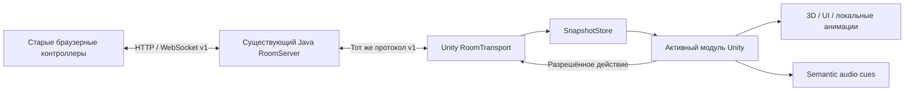

# Unity 6.6 — архитектура Final Answer

Статус: проектное решение, реализация не начата. Фактическая база и порядок этапов: [MIGRATION_PLAN](MIGRATION_PLAN.md). Первый production target — desktop Windows/macOS; телефоны работают на прежнем сайте Java-сервера.

## 1. Будущая структура

Структура ниже — схема, папка Unity и перечисленные классы сейчас **не создаются**.

```text
FinalAnswer/
  core/, lwjgl3/, shared/, server/, inspector/, gradle/  # действующий Java-эталон
  assets/                                               # неизменённые Java runtime-ресурсы
  source_assets/                                        # исходники медиа по назначению
  web/, web3d/                                          # старые контроллеры / отдельный Three.js-экран
  tools/, docs/migration/
  unity/FinalAnswer/                                     # будущий новый проект
    Assets/FinalAnswer/
      App/                 # Bootstrap, GameManager, composition root
      Shared/              # Contracts, Domain (pure C#)
      Infrastructure/      # Network, AssetCatalog, Audio, Persistence
      UI/                  # Menu, Lobby, Common, Fonts
      Games/
        LastCommand/       # Application, Presentation, Prefabs, Data, Art, Audio
        CursedBoxes/
        Impostor/
        Quiz/
      Scenes/              # Bootstrap, Shell, сцены мини-игр
      Editor/              # импорт/валидация данных, сборки
      Tests/               # EditMode, PlayMode
    Packages/              # manifest.json, packages-lock.json
    ProjectSettings/       # включая ProjectVersion.txt
```

Оригиналы остаются в `source_assets`; импортированные Unity-копии получают стабильные `.meta` GUID и связь с original SHA-256. Не импортировать всю Java-папку как Unity Assets и не менять Java-пути ради Unity. Не использовать symlinks как обязательную часть Windows/macOS clone.

В Unity Git хранит `Assets` вместе с `.meta`, `Packages`, `ProjectSettings`. `Library`, `Temp`, `Obj`, `Logs`, UserSettings и player builds исключаются будущими scoped-правилами. Нынешний .gitignore не меняется ради ещё не существующего Unity-проекта.

## 2. Assemblies и направление зависимостей

Минимальные будущие asmdef:

| Assembly | Ответственность | Разрешённые зависимости |
|---|---|---|
| `FA.Contracts` | Точные JSON DTO/envelopes, identifiers | Pure C#, выбранный JSON serializer; без UnityEngine |
| `FA.Domain` | Value objects, snapshot view, идентичность матча/игрока | Contracts; без UnityEngine |
| `FA.Application` | Порты room/round/audio/assets/results, use cases, module lifecycle | Domain, Contracts |
| `FA.Infrastructure` | HTTP/WS, clock, mixer backend, импортированные каталоги, локальное хранение | Application, Contracts, Unity APIs |
| `FA.UI` | Общие uGUI-presenters и навигация | Application, Domain, Unity APIs |
| `FA.LastCommand` и другие `FA.<Game>` | Только собственное представление/проекция/взаимодействия | Application, Domain, Contracts, Unity APIs |
| `FA.App` | Единственный composition root, связывает concrete services и модули | Infrastructure, UI, все подключаемые Games |
| `FA.Editor`, `FA.*.Tests` | Инструменты и проверки; исключены из player | Нужные runtime assemblies |

Application содержит интерфейсы инфраструктуры; не ссылается на concrete Network/Audio. Игры не ссылаются друг на друга, не вызывают `FindObjectOfType` для поиска глобальной комнаты и не создают свой WebSocket. GameManager не содержит правил 30 задач. Assembly boundaries соответствуют направлению зависимостей; циклов через `FA.App` быть не должно. Тестовые asmdef не включаются в production player ([Unity assembly definitions](https://docs.unity.com/en-us/engine/6000.6/manual/programming-environment/script-compilation/assembly-definition-files/assembly-definitions-creating)).

## 3. Владельцы и жизненный цикл

| Компонент (будущий) | Что делает | Чего в нём нет |
|---|---|---|
| `GameManager` | Владеет Application state machine, активным module scope и переходами сцен | Проверки ответов, хранения всех рычагов и прямого разбора WebSocket JSON |
| `RoomManager` | Create/join/leave, room code, roster, host credentials, ready connection state | Генерации задач и назначения победителя |
| `RoundCoordinator` | Применяет серверную фазу, ставит локальный presentation barrier, отправляет разрешённые ready команды | Второго авторитетного таймера/round counter |
| `SnapshotStore` | Принимает immutable snapshots, проверяет revision/session, уведомляет подписчиков | Побочных эффектов аудио или автоматических отправок в render |
| `ServerClock` | Оценка serverTime по monotonic local clock и измерениям PING/STATE | `DateTime.Now` как арбитра реакции |
| `ModuleScope` | Отмена async load, снятие подписок, освобождение scene/audio/RT/resources | Неограниченного статического event bus |
| `ResultRepository` | Сохраняет подтверждённый завершённый результат, идемпотентно | Восстановления авторитетной живой комнаты из локального JSON |

Локальная state machine: `Boot → Menu → RoomSetup → Lobby → LoadingModule → InModule → ReturningToLobby`; Settings — overlay. `Disconnected/Reconnecting` — ортогональное состояние соединения, не стирающее in-game snapshot. Серверные Protocol/Impostor/Cursed/LastCommand состояния хранятся отдельно. `RESULTS` викторины не превращается в единое универсальное `GameOver`.

Module lifecycle: `Load(context, cancellation) → Enter(snapshot) → ApplySnapshot(snapshot) → Tick(localDelta, serverNow) → Exit(reason) → Dispose`. Это контракт в документации; он не требует зеркального наследования Java Screen. Переход отменяет предыдущую загрузку, исключает её поздний callback, отпускает захваченный ввод и гасит локальные loops. Bootstrap/service root остаётся один; additive game scene выгружается. В сцене Bootstrap не копируются игровые модели каждой мини-игры.

В Unity 6.6 отдельно проверить повторный вход в Play Mode с актуальным режимом domain/scene reload: все static caches/listeners должны иметь явный сброс, а не полагаться на перезапуск домена.

## 4. Поток данных



Transport принимает JSON вне Unity API, собирает фрагменты сообщений и передаёт bounded очередь в main thread. `Update` применяет уже полученные snapshots; network callbacks не трогают `Transform`, `AudioSource` или Canvas. Нельзя терять важное промежуточное событие из-за безусловного «оставить только последний snapshot»; coalescing допустим только для доказанно заменяемого визуального состояния после извлечения смысловых переходов.

## 5. Стек и решения о зависимостях

- Unity 6.6 (6000.6.x), URP, Linear color space. Пробный импорт определит forward/forward+ и качество теней; HDRP не нужен как стартовое условие для имеющихся ассетов.
- C# в рамках поддерживаемого Unity API profile; базовая цель .NET Standard 2.1, без предположения о наличии desktop .NET 8/10 SDK в Unity player. Возможность transport проверить на фактическом patch/Mono и IL2CPP.
- `UnityWebRequest` для HTTP form API; `System.Net.WebSockets.ClientWebSocket` — первый кандидат desktop transport за интерфейсом. Не использовать NGO, Mirror, Photon или Relay для замены уже работающего browser WebSocket API.
- JSON: package Newtonsoft.Json в официальном Unity варианте, если он доступен в выбранном patch; pin version. Причина — динамические вложенные объекты/map в текущем payload. `JsonUtility` не выбран из-за такого контракта. Полиморфные unsafe type metadata отключены; DTO typed, неизвестные поля аккуратно сохраняются/игнорируются по контракту. AOT stripping проверяется player build, не только Editor.
- Unity Input System + один EventSystem; uGUI и TextMeshPro для оболочки и интерактивных экранов. World-space canvas/RenderTexture для CRT. Единая UI-технология сокращает расхождения; CSS напрямую не конвертируется в uGUI. Телефонный CSS остаётся в `web/`.
- glTFast — запланированный importer GLB. Editor import в native prefab предпочтительнее runtime parsing. Exact version подтверждается smoke-импортом существующих моделей.
- Cinemachine не обязательная зависимость: начальный camera rig повторяет существующий orbit/focus/damping. Подключать пакет только если он заменит конкретный объём camera work.
- Сцены/serialized references и локальный каталог ассетов достаточны для первого среза. Addressables — отложенное решение после измерения загрузки; собственный asset framework не нужен.

## 6. 3D, UI и анимации

Каждый механизм — prefab с устойчивым semantic ID, geometry child, interaction collider и отдельным pivot Transform. Исходный mesh transform сохраняется дочерним; калибровка сборки не запекается разрушительно в mesh. Статический корпус, cap большой кнопки, шарнир люка и ручка рычага независимы.

Kinematic transitions для кнопок/рычагов/регуляторов задаются target pose из snapshot плюс локальная anticipation. Не использовать Rigidbody simulation как источник правильного угла. Animator/Timeline подходят для длинных существующих кино-последовательностей; не создавать монолитный Animator с условиями всех задач. Presentation-ready отправляется по завершению нужного барьера ровно один раз.

Интерактивность вычисляется из requiredMechanisms/paused/readyAt/status, отдельно от видимости. Центральная красная кнопка остаётся видимой и может быть disabled. Луч камеры выбирает ближайшую твёрдую поверхность: корпус/закрытая дверца блокируют скрытые collider/UI. Ввод панели и вращение камеры имеют одного владельца на pointer gesture.

Шрифты должны поддерживать кириллицу и `☀ ☾ ★ ◆ × ÷ −`; проверять fallback и SDF atlas. Выбор Source glyphs выполняется по текущему контенту, без замены символов игрового задания на похожие пиктограммы.

## 7. Audio и настройки

Один app-level AudioService и mixer, module-level scopes. Mixer groups: Master → Music и SFX → UI/Mechanics/Environment/Cages/BoxDestruction/CharacterReveal; Voice — под SFX, чтобы начальная громкость повторяла нынешний `HostVoiceManager`, у которого нет отдельного persisted global voice slider. Отдельный Voice control возможен позже как осознанное UI-изменение.

Manifest cue → AudioClip + gain/priority/throttle; preload коротких клипов, streaming для длинных. Semantic event keys ограничены по памяти; local feedback и server echo не дают два клика. Voice — уже записанные OGG и утверждённый `voiceId`, без OS TTS. Окружение приглушается важным звуком и отключается в protected memory/silence задачах. DSP scheduling используется для пары light/note; кадры не перезапускают clips. Scope unload прекращает loops и освобождает ресурсы.

SettingsStore сохраняет display/language/reducedMotion/audio в локальном versioned JSON либо PlayerPrefs для простых чисел. Не копировать платформенный файл libGDX Preferences вслепую. UI и audio preference — локальны, результат матча — подтверждённый серверный факт.

## 8. Результаты и процедурная генерация

Первый этап: генератор, сложности, вес категорий, память, тайминги и оценка остаются в Java `CommandRace`/других sessions. В Unity хранятся только DTO/public parameters и проекции. Никакого `UnityEngine.Random` для повторного получения «того же ответа» по seed.

Отдельный будущий `IGameRules`-порт понадобится только при согласованном C# backend. Совместимость требует явного PRNG, integer semantics, seed serialization и corpus fixtures; `System.Random` не является заменой `java.util.Random` один к одному.

Новая локальная история результатов: versioned DTO с backend identity + roomId + sessionId/gameId + gameKind, roster, confirmed outcome, серверными timestamps и итоговыми scores. Идемпотентный upsert по ключу, запись во временный файл в `Application.persistentDataPath`, flush/atomic replace с сохранением предыдущей версии и recovery при повреждении. Хранить без tokens/password/тайных ответов. При отсутствии terminal snapshot запись «ожидает подтверждения», не «победа». Это архив отображения, не источник повторного начисления очков. Серверная долговременная БД и восстановление после server restart — последующий самостоятельный этап.

## 9. Проверки перед масштабированием

- EditMode: DTO fixtures, time estimates, session/revision reducer, pending numeric input/rebase, audio dedup, result idempotency.
- PlayMode: module cancellation, unload/reload, one EventSystem/AudioListener, захват указателя, инертные скрытые механизмы, исчезновение CRT note при закрытии.
- Standalone: macOS/Windows, выбранные Mono/IL2CPP, реальные HTTP/WS, фоновое окно продолжает принимать сеть; OS focus loss освобождает input. Пауза локального окна не меняет серверные deadlines самовольно.
- Производительность: заранее загруженные clips/models, без новых mesh/material/RT на каждую цифру, MaterialPropertyBlock для локальной эмиссии где возможно, ограниченный пул источников, контролируемый RT refresh, одна теневая key light по стартовому бюджету. Лимиты уточнить по профилю, не по FPS Java.

Связанные документы: [сеть](NETWORK_ARCHITECTURE.md), [ассеты](ASSET_MIGRATION.md), [Last Command](THE_LAST_COMMAND_PLAN.md). Официальные материалы: [Unity 6.6 Manual](https://docs.unity.com/en-us/engine/6000.6/manual), [glTFast editor import](https://github.com/Unity-Technologies/com.unity.cloud.gltfast/blob/main/Packages/com.unity.cloud.gltfast/Documentation~/ImportEditor.md). Конкретный выбор C#/UI/URP в этом документе — проектное решение; готовность пакетов для выбранного patch проверяется на этапе foundation.
